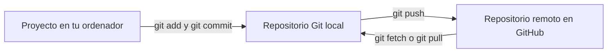
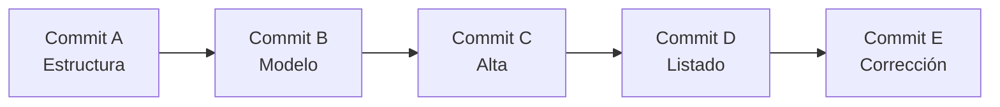

# 1. Introducción al control de versiones

## 1.1. ¿Por qué necesitamos controlar las versiones de un proyecto?

Imagina que estás desarrollando una aplicación Java para gestionar una biblioteca. El lunes consigues que funcione el registro de libros; el martes añades la búsqueda; el miércoles modificas varias clases para incorporar préstamos y, de repente, deja de funcionar la búsqueda que ya tenías terminada.

Si no dispones de un sistema de control de versiones, probablemente intentarás recordar qué modificaste, deshacer cambios manualmente o recuperar alguna copia antigua. Es habitual terminar con carpetas como estas:

```text
Biblioteca/
Biblioteca_copia/
Biblioteca_final/
Biblioteca_final_buena/
Biblioteca_final_buena_2/
```

Este procedimiento presenta varios problemas:

- **No sabemos exactamente qué cambió** entre una copia y otra.
- **No conocemos el motivo de los cambios** ni quién los realizó.
- **Podemos perder trabajo** al sobrescribir archivos.
- **Es difícil volver a una versión que funcionaba** sin descartar otras mejoras.
- **Colaborar resulta complicado**: dos personas pueden modificar el mismo archivo y una terminar sobrescribiendo el trabajo de la otra.

Un sistema de control de versiones permite gestionar estos problemas de forma organizada.

!!! example "Situación real en clase"
    Dos estudiantes desarrollan conjuntamente una aplicación. Uno modifica `Producto.java` para añadir el precio y el otro lo modifica para añadir el stock. Si se intercambian el archivo por correo y sustituyen una copia por otra, pueden perder parte del trabajo. Con Git pueden registrar sus cambios, compartirlos e integrarlos de forma controlada; si ambos modifican la misma parte del archivo, Git puede pedirles que resuelvan el conflicto.

## 1.2. ¿Qué es un sistema de control de versiones?

Un **sistema de control de versiones** (VCS, *Version Control System*) es una herramienta que registra la evolución de los archivos de un proyecto a lo largo del tiempo. Permite identificar los cambios realizados y recuperar estados anteriores.

En desarrollo de software se utiliza principalmente con código fuente, pero también puede gestionar documentación, configuraciones, pruebas y otros archivos de texto.

Sus principales ventajas son:

| Necesidad | Qué aporta el control de versiones |
|---|---|
| Conservar la evolución del proyecto | Un historial de versiones registradas. |
| Saber qué se modificó | Comparaciones entre versiones. |
| Entender por qué se cambió algo | Mensajes asociados a cada versión registrada. |
| Recuperar trabajo anterior | Acceso a versiones previas. |
| Trabajar en funcionalidades distintas | Ramas de desarrollo. |
| Colaborar | Mecanismos para intercambiar e integrar cambios. |

!!! important "Una idea fundamental"
    Git **no guarda automáticamente cada pulsación de teclado**. El desarrollador decide qué cambios preparar y cuándo registrar una nueva versión mediante un *commit*. Tampoco sustituye por sí solo a una estrategia de copias de seguridad.

## 1.3. ¿Cómo se trabajaba antes de Git? Tipos de sistemas

### Sistemas locales

Las primeras soluciones podían mantener un historial de versiones en un único ordenador. Facilitaban recuperar cambios, pero no resolvían bien la colaboración entre equipos.

### Sistemas centralizados

En un sistema centralizado, como **Subversion (SVN)**, existe un servidor principal que conserva el repositorio. Los desarrolladores obtienen copias de trabajo y se comunican con ese servidor para registrar o recuperar versiones.

**Ventaja:** un punto central de administración. **Limitación:** determinadas operaciones dependen de la disponibilidad y conectividad con el servidor.

### Sistemas distribuidos

En un sistema distribuido como **Git**, cada clon habitual del repositorio contiene el historial del proyecto, no solo los archivos actuales. Por eso es posible consultar commits y crear nuevas versiones localmente, incluso sin conexión a Internet.

Posteriormente, los cambios pueden intercambiarse con otros repositorios, por ejemplo con uno alojado en GitHub.

| Característica | Centralizado (ej. SVN) | Distribuido (ej. Git) |
|---|---|---|
| Historial principal | Se mantiene en un servidor central | Cada clon completo dispone de historial |
| Commits sin conexión al servidor | Habitualmente no | Sí |
| Colaboración | Mediante servidor central | Mediante intercambio entre repositorios |
| Ejemplo | Subversion | Git |

!!! note "No confundas distribuido con público"
    Un repositorio Git puede existir únicamente en tu ordenador. No necesitas una cuenta de GitHub para utilizar Git.

## 1.4. ¿Qué es Git?

**Git** es un sistema de control de versiones distribuido, creado inicialmente por Linus Torvalds en 2005 para facilitar el desarrollo del núcleo Linux.

Git permite:

1. Crear un repositorio para un proyecto.
2. Detectar archivos nuevos y cambios en los existentes.
3. Seleccionar los cambios que formarán parte de una versión.
4. Registrar esa versión mediante un **commit**.
5. Consultar el historial y comparar versiones.
6. Crear ramas para desarrollar funcionalidades de manera independiente.
7. Intercambiar e integrar cambios con otros repositorios.

Git funciona desde la terminal, aunque también puede utilizarse mediante interfaces gráficas como las herramientas de control de versiones de Visual Studio Code.

## 1.5. ¿Qué es GitHub? ¿Es lo mismo que Git?

**GitHub** es una plataforma en línea que permite alojar repositorios Git y añade servicios de colaboración y gestión de proyectos: solicitudes de incorporación de cambios (*pull requests*), incidencias (*issues*), revisiones de código, automatizaciones y más.

**Git es la herramienta de control de versiones; GitHub es un servicio que puede alojar y facilitar el trabajo con repositorios Git.**

| Git | GitHub |
|---|---|
| Programa de control de versiones | Plataforma web de alojamiento y colaboración |
| Se instala y ejecuta localmente | Se utiliza principalmente mediante Internet |
| Gestiona commits, ramas e historial | Aloja repositorios y facilita compartirlos |
| Puede funcionar sin GitHub | Utiliza Git como base para sus repositorios |

!!! tip "Ejemplo sencillo"
    Puedes desarrollar una aplicación Java en tu ordenador y registrar veinte commits con Git sin subirla a ninguna plataforma. Si después quieres compartir el código con tus compañeros, puedes crear un repositorio en GitHub y enviar allí tus commits.

GitHub no es el único servicio de alojamiento de repositorios Git. Existen otras alternativas, como GitLab y Bitbucket.

## 1.6. Repositorio local y repositorio remoto

Un **repositorio** es el conjunto de información que Git utiliza para gestionar el historial y las referencias de un proyecto. En un repositorio local normal, esa información se almacena en una carpeta interna llamada `.git`.

- **Repositorio local:** el que utilizas en tu ordenador para registrar y consultar versiones.
- **Repositorio remoto:** otro repositorio con el que puedes intercambiar cambios; por ejemplo, uno alojado en GitHub.



En el diagrama aparecen comandos que estudiaremos más adelante:

- **`git add`**: prepara cambios para el siguiente commit.
- **`git commit`**: registra una versión en el repositorio local.
- **`git push`**: envía commits y referencias al remoto.
- **`git fetch`**: obtiene información del remoto sin integrarla automáticamente en la rama actual.
- **`git pull`**: obtiene cambios remotos e intenta integrarlos en la rama actual.

!!! warning "Guardar no es lo mismo que publicar"
    Guardar un archivo en VS Code **no crea un commit**. Crear un commit **no lo sube a GitHub**. Y subir código a GitHub **no publica automáticamente una página web**.

## 1.7. Conceptos fundamentales que debes conocer

### Directorio de trabajo (*working directory*)

Es la carpeta donde editas los archivos del proyecto: por ejemplo, `App.java`, `pom.xml` o `README.md`.

### Zona de preparación (*staging area* o *index*)

Es el conjunto de cambios seleccionados para formar parte del próximo commit. Permite decidir qué incluir y qué dejar fuera.

### Commit

Es un registro de una versión del proyecto. Tiene un identificador (*hash*), un autor, una fecha, un mensaje y una relación con commits anteriores, entre otros datos.

Un commit no es simplemente «un archivo guardado»: representa un estado registrado del proyecto dentro de su historial.

### Historial

Es la secuencia y relación entre los commits. Permite reconstruir cómo evolucionó el proyecto.

### Rama (*branch*)

Es una referencia que permite seguir una línea de desarrollo. Por ejemplo, puedes conservar una rama `main` estable mientras desarrollas una nueva función en `feature/busqueda`.

### Fusión (*merge*) y conflicto

Una **fusión** integra cambios de distintas líneas de desarrollo. Un **conflicto** puede aparecer cuando Git no puede decidir automáticamente cómo combinar cambios incompatibles. Entonces una persona debe revisar y resolver la situación.

### Clonar (*clone*)

Consiste en obtener una copia local de un repositorio existente, incluyendo su historial y referencias necesarias para trabajar con él.

### README y .gitignore

- **`README.md`**: documento de presentación e instrucciones del proyecto.
- **`.gitignore`**: archivo con reglas para indicar qué archivos no seguidos debe ignorar Git, como resultados de compilación o configuraciones locales. No elimina del seguimiento archivos que ya estuvieran registrados.

## 1.8. Ejemplo: evolución de una aplicación Java

Imagina que desarrollamos un programa llamado **Gestor de tareas**. A lo largo de varios días realizamos estos cambios:

| Día | Cambio realizado | Commit propuesto |
|---|---|---|
| Lunes | Crear el proyecto y un menú de consola | `Crear estructura inicial del proyecto` |
| Martes | Incorporar la clase `Tarea` | `Añadir modelo de tareas` |
| Miércoles | Permitir registrar tareas | `Implementar alta de tareas` |
| Jueves | Añadir listado de tareas | `Mostrar tareas registradas` |
| Viernes | Corregir un error del listado | `Corregir visualización de tareas` |

Cada commit nos permite identificar un punto concreto de la evolución. Si el viernes detectamos un problema, podremos comparar los cambios con versiones anteriores para localizar su origen.



!!! note "Una precisión importante"
    Git no comprueba si un programa funciona ni decide qué cambios son correctos. Registra versiones; las pruebas, revisiones y decisiones técnicas siguen siendo responsabilidad de quienes desarrollan el proyecto.

## 1.9. ¿Cómo ayuda Git al trabajo en equipo?

Supongamos que dos estudiantes trabajan en el mismo proyecto:

- **Ana** desarrolla el registro de tareas en una rama.
- **Luis** desarrolla la búsqueda de tareas en otra rama.
- Ambos registran sus avances con commits.
- Cuando terminan, integran los cambios y revisan que la aplicación siga funcionando.

Git permite mantener historiales de trabajo y ofrece herramientas para integrar los cambios. GitHub añade mecanismos de colaboración, como las *pull requests*, que permiten proponer cambios, comentarlos y revisarlos antes de incorporarlos.

!!! warning "Git no evita todos los conflictos"
    Si dos personas modifican de manera incompatible la misma parte de un archivo, es posible que tengan que resolver un conflicto manualmente. Git ayuda a detectar y gestionar la situación; no sustituye la comunicación entre compañeros.

## 1.10. Buenas prácticas desde el principio

1. **Realiza commits con sentido:** registra cambios relacionados entre sí, en lugar de mezclar modificaciones inconexas.
2. **Escribe mensajes descriptivos:** `Corregir cálculo del precio total` es más útil que `Cambios`.
3. **Revisa los archivos antes de incluirlos:** evita subir contraseñas, tokens, claves privadas y datos personales.
4. **No subas archivos generados innecesarios:** por ejemplo, la carpeta `target/` de Maven suele excluirse con `.gitignore`.
5. **Sincroniza el trabajo compartido:** antes de colaborar, comprueba qué cambios existen en el repositorio remoto.
6. **No confundas Git con una copia de seguridad completa:** conviene mantener respaldos adecuados y proteger el acceso a los repositorios.

## 1.11. Actividades de comprensión

### Actividad 1. El problema de las copias manuales

Un estudiante conserva estas carpetas:

```text
Calculadora/
Calculadora_final/
Calculadora_final_2/
Calculadora_ultima/
```

Explica al menos **cuatro problemas** que pueden surgir al trabajar así y cómo ayudaría Git a resolverlos.

### Actividad 2. Git o GitHub

Indica si cada situación corresponde principalmente a **Git**, a **GitHub** o a **ambos**, y justifica tu respuesta:

1. Registrar un commit sin conexión a Internet.
2. Abrir una *pull request* para revisar una modificación.
3. Consultar el historial de versiones de un proyecto local.
4. Compartir un repositorio privado con otro estudiante mediante una plataforma web.
5. Integrar cambios de dos ramas de un repositorio.

### Actividad 3. Ordenar un flujo de trabajo

Ordena conceptualmente estas acciones para registrar y compartir una modificación: **editar un archivo, crear un commit, preparar los cambios, enviar los commits al remoto**.

Explica por qué guardar un archivo no significa que ya esté disponible en GitHub.

### Actividad 4. Caso de colaboración

Dos compañeros modifican la misma línea de `App.java` de manera diferente. ¿Qué puede suceder al intentar integrar sus cambios? ¿Quién debe decidir la versión final?

??? success "Orientaciones de solución"
    **Actividad 1:** pérdida de cambios, dificultad para identificar la última versión, desconocimiento del autor y de los motivos de cada modificación, problemas al combinar el trabajo. Git proporciona historial, comparación y mecanismos de integración.

    **Actividad 2:** 1. Git; 2. GitHub; 3. Git; 4. GitHub; 5. Git. En el último caso, la integración puede gestionarse mediante herramientas de GitHub, pero la operación de control de versiones corresponde a Git.

    **Actividad 3:** editar → preparar (`git add`) → registrar (`git commit`) → enviar (`git push`). Guardar en el editor solo modifica el archivo local.

    **Actividad 4:** puede producirse un conflicto que deberá resolver una persona revisando qué comportamiento necesita el programa.

## 1.12. Comprueba lo aprendido

Antes de continuar, deberías poder responder sin consultar los apuntes:

- ¿Qué problema resuelve un sistema de control de versiones?
- ¿Qué diferencia hay entre Git y GitHub?
- ¿Puede utilizarse Git sin Internet? ¿Y sin cuenta de GitHub?
- ¿Qué diferencia hay entre un repositorio local y uno remoto?
- ¿Qué es un commit y por qué debe llevar un mensaje claro?
- ¿Para qué sirve una rama?
- ¿Qué diferencia existe entre guardar, hacer un commit y ejecutar un push?
- ¿Por qué Git no sustituye a las pruebas de software ni a las copias de seguridad?

## 1.13. Recursos para ampliar

- [Sitio oficial de Git](https://git-scm.com/)
- [Libro *Pro Git* (gratuito)](https://git-scm.com/book/es/v2)
- [Documentación de GitHub](https://docs.github.com/es)

---

**Siguiente capítulo:** [2. Instalación y configuración de Git](02-instalacion.md).
