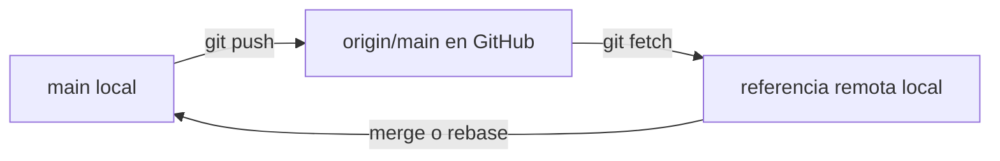

# 6. GitHub y repositorios remotos

## 6.1. Local no significa remoto

El repositorio de tu ordenador conserva sus commits. GitHub aloja otro repositorio con el que puedes intercambiar versiones. **Crear commits no los publica automáticamente**: es necesario configurar un remoto y ejecutar una operación de sincronización.



`origin` es un nombre convencional para el remoto principal. Puedes utilizar otro nombre y tener varios remotos.

## 6.2. Crear un repositorio en GitHub

1. Accede a [github.com/new](https://github.com/new) con tu cuenta.
2. Escribe el nombre y decide si será público o privado.
3. Si ya tienes un proyecto local con commits, **no inicialices** el remoto con README, licencia ni `.gitignore`: evitarás historiales iniciales independientes.
4. Copia la URL HTTPS que ofrece GitHub.

!!! warning "Repositorio público"
    Antes de publicar comprueba que no hay contraseñas, tokens, datos personales del alumnado ni archivos de configuración sensibles. Eliminar un secreto del último commit no garantiza eliminarlo del historial publicado.

## 6.3. Conectar el repositorio local

```bash
git remote add origin https://github.com/USUARIO/REPOSITORIO.git
git remote -v
```

Sustituye `USUARIO` y `REPOSITORIO`. `remote add` solo guarda la dirección: **no descarga ni sube archivos**. Para cambiar una URL incorrecta:

```bash
git remote set-url origin https://github.com/USUARIO/NUEVO.git
```

## 6.4. Primera publicación

```bash
git push -u origin main
```

`push` envía los commits y actualiza la rama remota si es posible; `-u` configura el seguimiento (*upstream*). En futuras ocasiones suele bastar con `git push`.

Si GitHub rechaza el push por `non-fast-forward`, **no uses `--force` automáticamente**. Significa que la rama remota contiene historia que tu rama local no integra; revisa antes de actuar.

## 6.5. Clonar un repositorio existente

```bash
git clone https://github.com/USUARIO/REPOSITORIO.git
cd REPOSITORIO
git remote -v
```

`clone` descarga el historial disponible y crea una copia de trabajo vinculada al remoto. **No ejecutes `git init` dentro de una carpeta ya clonada**.

## 6.6. Diferencias entre `fetch`, `pull` y `push`

| Comando | Qué hace | ¿Integra cambios en la rama actual? |
|---|---|---|
| `git fetch origin` | Descarga objetos y actualiza referencias remotas | No |
| `git pull` | Hace `fetch` e integra mediante merge o rebase, según configuración | Sí |
| `git push` | Envía commits y referencias al remoto | No modifica tu directorio local |

Flujo seguro para comprobar antes de integrar:

```bash
git fetch origin
git log --oneline --graph --decorate --all
git merge origin/main
```

Si tu rama tiene cambios locales no confirmados, conviene hacer commit o guardarlos con `stash` antes de integrar. La configuración de `pull` puede exigir elegir entre merge y rebase cuando las ramas han divergido.

## 6.7. ¿Qué son `main` y `origin/main`?

`main` es la rama local. `origin/main` es la referencia local que registra el estado conocido de la rama `main` del remoto; se actualiza mediante `fetch` o ciertas operaciones de sincronización. No se actualiza mágicamente cuando alguien cambia GitHub.

## 6.8. Error práctico: dos README iniciales

Si creas un README en GitHub y otro localmente, puedes acabar con dos historiales iniciales independientes. Antes de integrarlos, consulta:

```bash
git fetch origin
git log --oneline --graph --all
git ls-tree -r --name-only origin/main
```

Una integración de historiales independientes puede requerir `git merge origin/main --allow-unrelated-histories`, pero solo tras comprobar que **realmente quieres unirlos**. Si hay conflictos, tendrás que resolverlos y finalizar el commit de fusión. No ejecutes comandos destructivos para ocultar el problema.

## Actividades

1. Crea un repositorio remoto vacío y publica `HolaGit`.
2. Clónalo en otra carpeta y comprueba `git log`.
3. Modifica el README desde GitHub, ejecuta `git fetch` localmente y explica por qué aún no ves el cambio en tu archivo de trabajo.
4. Integra la actualización y comprueba el estado.

??? success "Comprobación"
    Después de `fetch`, la referencia `origin/main` puede avanzar sin cambiar `main`; después de una integración correcta, `main` incorpora los cambios remotos.

**Siguiente:** [Autenticación y seguridad](07-autenticacion.md).
