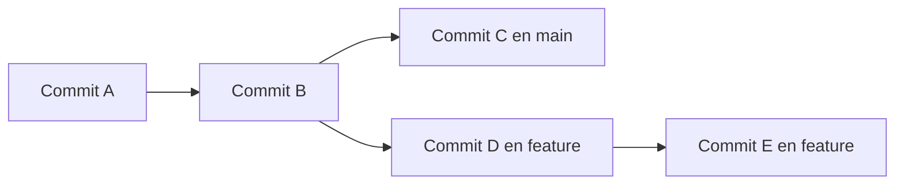

# 8. Ramas: desarrollar sin alterar la versión principal

## 8.1. Qué es una rama

Una **rama** es una referencia móvil a un commit. Permite desarrollar una funcionalidad, corregir un error o experimentar sin registrar todos los cambios directamente en `main`. Crear una rama no duplica físicamente todo el proyecto.



En el dibujo, `main` y `feature` comparten historia hasta B y después evolucionan por separado.

## 8.2. Consultar y crear ramas

```bash
git branch
git branch -a
git switch -c feature/menu
```

`branch` lista ramas locales; `-a` incluye referencias remotas. `switch -c` crea una rama y cambia a ella. El nombre `feature/menu` es una convención para describir su propósito.

Comprueba:

```bash
git status
git branch --show-current
```

## 8.3. Trabajo guiado con dos ramas

En el proyecto `HolaGit`, crea una rama:

```bash
git switch -c feature/saludo
```

Modifica el mensaje de `HolaGit.java`, guarda y registra:

```bash
git add HolaGit.java
git commit -m "Personalizar mensaje de saludo"
```

Vuelve a la principal:

```bash
git switch main
```

Observa el contenido de `HolaGit.java`: debería corresponder al estado de `main`, no al de la rama de funcionalidad. Cambia de nuevo a la rama y comprueba la diferencia.

!!! warning "Cambios sin commit al cambiar de rama"
    Git puede impedir `switch` si perderías modificaciones del directorio de trabajo. No fuerces el cambio: primero confirma, guarda temporalmente o descarta conscientemente esos cambios.

## 8.4. Publicar una rama en GitHub

```bash
git push -u origin feature/saludo
```

Esto crea o actualiza la rama remota y establece seguimiento. No integra sus cambios en `main`. En GitHub podrás abrir una *pull request* para proponer su incorporación.

## 8.5. Renombrar y eliminar ramas

```bash
git branch -m feature/saludo feature/mensaje-bienvenida
git branch -d feature/mensaje-bienvenida
```

`-d` evita borrar una rama local si Git considera que tiene cambios no integrados. `-D` fuerza el borrado: úsalo solo si comprendes que podrías perder referencias a commits no incorporados. No puedes eliminar la rama activa: cambia antes a otra.

Para eliminar una rama remota ya innecesaria:

```bash
git push origin --delete feature/mensaje-bienvenida
```

## 8.6. Ramas y HEAD

Normalmente `HEAD` apunta a la rama activa; al crear un commit, esa rama avanza. Si seleccionas directamente un commit histórico, puedes quedar en estado *detached HEAD*: no es un error, pero conviene crear una rama si vas a conservar nuevos commits.

## Actividades

1. Crea una rama `feature/despedida`, añade un segundo mensaje y registra el cambio.
2. Vuelve a `main` y explica por qué no aparece todavía la funcionalidad.
3. Dibuja el historial con `git log --oneline --graph --all`.
4. Explica por qué es conveniente dar nombres descriptivos a las ramas.

??? success "Comprobación"
    La nueva funcionalidad debe estar registrada en la rama `feature/despedida`, mientras `main` conserva su contenido anterior. Los commits comparten un antecesor común.

**Siguiente:** [Fusiones y conflictos](09-fusiones.md).
