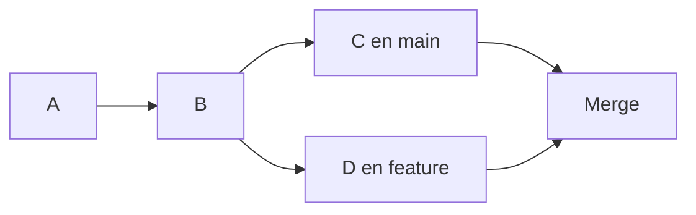

# 9. Fusiones y resolución de conflictos

## 9.1. Qué significa fusionar

**Fusionar** (*merge*) significa integrar en una rama el trabajo desarrollado en otra. Lo habitual es situarse en la rama que recibirá los cambios y ejecutar `git merge nombre-rama`.

```bash
git switch main
git merge feature/despedida
```

No confundas el orden: el comando anterior incorpora `feature/despedida` **en** `main`.

## 9.2. Fast-forward y merge con commit

Si `main` no ha avanzado desde que creaste la rama, Git puede mover la referencia hacia delante: **fast-forward**. Si ambas ramas contienen commits nuevos, Git puede crear un **commit de fusión** con dos padres.



El commit de fusión conserva la relación entre las dos líneas de trabajo. No todas las fusiones crean un commit adicional.

## 9.3. Qué es un conflicto

Git suele combinar automáticamente cambios realizados en zonas diferentes. Aparece un conflicto cuando no puede decidir con seguridad cómo integrar modificaciones incompatibles, por ejemplo cuando dos ramas cambian la misma línea.

Supón que `main` contiene:

```java
System.out.println("Bienvenido al inventario");
```

Y otra rama contiene:

```java
System.out.println("Bienvenido a la aplicación");
```

Si ambas modificaciones compiten en una fusión, Git puede insertar marcadores como:

```text
<<<<<<< HEAD
System.out.println("Bienvenido al inventario");
=======
System.out.println("Bienvenido a la aplicación");
>>>>>>> feature/mensaje
```

`HEAD` señala la versión de la rama en la que estás fusionando. Los marcadores **no son código válido**: debes editar el archivo, decidir el resultado final y eliminar los delimitadores.

## 9.4. Resolver el conflicto paso a paso

1. Ejecuta `git status` para identificar los archivos en conflicto.
2. Abre cada archivo y decide qué contenido conservar o cómo combinar ambas versiones.
3. Elimina `<<<<<<<`, `=======` y `>>>>>>>`.
4. Compila o ejecuta pruebas: resolver marcadores no garantiza que el programa funcione.
5. Marca el archivo como resuelto y finaliza:

```bash
git add HolaGit.java
git commit
```

Si Git propone un mensaje de fusión, revísalo y guárdalo. Para cancelar una fusión en curso antes de resolverla:

```bash
git merge --abort
```

## 9.5. Qué significan `--ours` y `--theirs`

Durante un **merge**, `--ours` representa la versión de la rama actual y `--theirs` la que se está incorporando:

```bash
git checkout --ours HolaGit.java
git add HolaGit.java
```

Esto conserva una versión completa del archivo y **descarta la otra versión para ese archivo**. No lo utilices sin revisar. Durante un *rebase*, la interpretación práctica de estas opciones puede resultar contraintuitiva; comprueba siempre el contexto.

## 9.6. Conflictos por historiales independientes

Si un repositorio se inicializó localmente y otro en GitHub, pueden existir dos commits iniciales sin relación. `git merge origin/main --allow-unrelated-histories` permite unirlos, pero **no debe ser una receta automática**: primero revisa qué archivos existen y si realmente quieres conservar ambos historiales.

## 9.7. Actividad guiada de conflicto

1. Crea dos ramas desde el mismo commit: `feature/saludo-a` y `feature/saludo-b`.
2. Cambia la misma línea de `HolaGit.java` de manera diferente en cada rama y registra cada cambio.
3. Integra una rama en `main` y después intenta integrar la otra.
4. Resuelve el conflicto combinando las ideas en un único mensaje; compila el programa.
5. Consulta `git log --oneline --graph --all` y explica el resultado.

??? success "Qué se evalúa"
    Debes identificar el archivo conflictivo, explicar las dos versiones, producir un archivo sin marcadores, comprobar que funciona y terminar la fusión con un commit cuando corresponda.

**Siguiente:** [Trabajo colaborativo](10-colaboracion.md).
