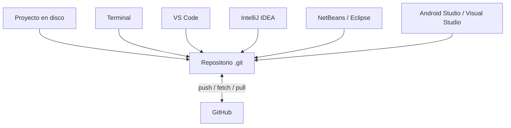

# 13. Git y GitHub desde los entornos de desarrollo

En los capítulos anteriores hemos trabajado con Git desde la terminal. En este capítulo aprenderás a utilizar las herramientas gráficas de **Visual Studio Code, IntelliJ IDEA, Apache NetBeans, Eclipse, Android Studio y Visual Studio**, sin perder de vista qué operación Git se ejecuta realmente.

!!! info "Objetivos de aprendizaje"
    Al finalizar podrás reconocer el estado de un repositorio desde diferentes IDE, preparar cambios, crear commits, consultar el historial, gestionar ramas, sincronizar con GitHub y resolver conflictos. También sabrás cambiar de IDE **sin perder el historial del proyecto**.

!!! note "Sobre los menús y las versiones"
    Los nombres exactos de menús, iconos y ventanas pueden variar según la versión del IDE, el sistema operativo, el idioma de la interfaz y los complementos instalados. Se indican las rutas habituales y, cuando conviene, el **comando Git equivalente**, que es la referencia estable. En caso de duda, abre la terminal del proyecto y consulta `git status`.

## 13.1. Git no pertenece al IDE

Git es un sistema de control de versiones independiente. Un IDE es una aplicación que permite editar, ejecutar y depurar código; puede incluir una interfaz gráfica para invocar Git.

Si un proyecto contiene una carpeta `.git/` en su raíz, sus commits, ramas y configuración de remotos seguirán existiendo aunque lo abras con otro editor. Por ejemplo, puedes crear un repositorio en PowerShell, abrirlo con NetBeans, realizar un commit desde IntelliJ IDEA y consultar el historial con VS Code.



!!! warning "No confundir Git y GitHub"
    Un **commit** se registra primero en el repositorio local. Un **push** publica commits en un remoto como GitHub. Los botones del IDE pueden combinar varias operaciones; comprueba qué hacen antes de utilizarlos.

### 13.1.1. Los tres espacios de trabajo

| Espacio | Qué contiene | Cómo se consulta |
|---|---|---|
| Directorio de trabajo | Archivos que editas | Explorador del IDE y `git status` |
| Zona de preparación (*staging area*) | Cambios elegidos para el próximo commit | Panel Git y `git diff --cached` |
| Repositorio local | Commits e historial | Historial del IDE y `git log --oneline` |

Un archivo puede tener **cambios preparados y cambios sin preparar a la vez**. No todos los IDE presentan esa distinción del mismo modo. Por ello, es fundamental revisar el contenido real del commit antes de confirmarlo.

### 13.1.2. Tabla de equivalencias

| Objetivo | Comando Git | Acción gráfica habitual |
|---|---|---|
| Ver el estado | `git status` | Vista Git / Source Control / Git Changes |
| Preparar un archivo | `git add archivo` | Stage / Add |
| Registrar cambios | `git commit -m "Mensaje"` | Commit |
| Ver diferencias | `git diff` | Diff / Compare |
| Consultar historial | `git log --oneline` | Log / History |
| Crear una rama | `git switch -c nueva-rama` | New Branch |
| Cambiar de rama | `git switch nombre` | Checkout / Switch |
| Obtener referencias remotas | `git fetch` | Fetch |
| Integrar cambios remotos | `git pull` | Pull / Update Project, según IDE |
| Publicar commits | `git push` | Push |

## 13.2. Preparación común para todos los IDE

Antes de comenzar:

1. Instala Git y verifica su disponibilidad: `git --version`.
2. Configura tu identidad si todavía no lo has hecho:

   ```bash
   git config --global user.name "Nombre Apellido"
   git config --global user.email "correo@example.com"
   ```

3. Crea o clona un repositorio de práctica.
4. Abre **la carpeta raíz del proyecto**, la que contiene `.git/` (puede estar oculta), y no únicamente un archivo `.java`.
5. Comprueba el estado desde una terminal del IDE:

   ```bash
   git status -sb
   git remote -v
   ```

!!! tip "Windows y Linux"
    Los comandos de Git son esencialmente los mismos en PowerShell, Git Bash y terminales Linux. Las rutas y la forma de abrir una terminal sí pueden cambiar. En los equipos del aula con Pop!_OS puedes trabajar con la terminal integrada del IDE.

### Repositorio de práctica compartido

Para los ejercicios utilizaremos una carpeta sencilla:

```text
hola-git-ide/
├── README.md
└── HolaGit.java
```

Contenido de `HolaGit.java`:

```java
public class HolaGit {
    public static void main(String[] args) {
        System.out.println("Hola desde Git");
    }
}
```

Si todavía no existe el repositorio:

```bash
mkdir hola-git-ide
cd hola-git-ide
git init
```

Crea los dos archivos, prepara los cambios y registra la primera versión:

```bash
git add README.md HolaGit.java
git commit -m "Crear ejemplo inicial para practicar Git"
```

!!! note "Si el repositorio ya existe"
    No vuelvas a ejecutar `git init` ni recrees los archivos. Abre el proyecto existente y utiliza `git status` para conocer su situación.

## 13.3. Git en Visual Studio Code

**Visual Studio Code** incluye funciones básicas de Git sin instalar extensiones adicionales. Su panel **Source Control** permite revisar archivos, preparar cambios, crear commits y trabajar con ramas y remotos.

### 13.3.1. Abrir el proyecto y localizar el panel Git

1. Abre VS Code.
2. Selecciona **File → Open Folder** (*Archivo → Abrir carpeta*).
3. Abre la carpeta `hola-git-ide`.
4. Selecciona el icono **Source Control** en la barra lateral (habitualmente `Ctrl+Shift+G`).
5. Comprueba que VS Code detecta el repositorio y muestra la rama actual.

Si el panel ofrece **Initialize Repository**, asegúrate primero de que no has abierto una carpeta distinta de la raíz. Inicializar otro repositorio por error puede complicar el trabajo.

### 13.3.2. Modificar, comparar y preparar

1. Cambia el texto del `System.out.println` y guarda el archivo.
2. Abre **Source Control**: `HolaGit.java` debería aparecer como modificado (`M`).
3. Selecciona el archivo para abrir la comparación (*diff*): a un lado verás la versión anterior y al otro la nueva.
4. Utiliza **Stage Changes** (`+`) para preparar el cambio.
5. Comprueba que pasa a **Staged Changes**.

Equivalente en terminal:

```bash
git diff HolaGit.java
git add HolaGit.java
git diff --cached
```

!!! warning "Stage no significa commit"
    Preparar un archivo solo selecciona los cambios que entrarán en el siguiente commit. Todavía no se ha creado una versión en el historial.

### 13.3.3. Crear el commit y verificarlo

1. Escribe el mensaje `Modificar saludo de la aplicación`.
2. Pulsa **Commit**.
3. Abre la terminal integrada (**Terminal → New Terminal**) y ejecuta:

   ```bash
   git log --oneline -3
   git status
   ```

Si el IDE ofrece crear un commit con todos los cambios sin preparar, revisa primero qué archivos se incluirán. Es preferible entender la zona de preparación y utilizarla explícitamente durante el aprendizaje.

### 13.3.4. Ramas, remotos y conflictos

- Para crear o cambiar de rama, utiliza el indicador de rama de la barra inferior o la paleta de comandos (`Ctrl+Shift+P`).
- Para publicar o descargar, utiliza **Push**, **Pull**, **Fetch** o las acciones de sincronización.
- **Sync Changes** puede ejecutar más de una operación; no lo confundas con un simple `push`.
- Ante conflictos, VS Code puede ofrecer un editor de fusiones (*Merge Editor*) o acciones para aceptar cambios. Revisa el resultado completo antes de darlo por resuelto.

Comprueba siempre:

```bash
git branch -vv
git status
```

### 13.3.5. Extensiones opcionales

Extensiones como **GitLens** pueden facilitar la consulta del historial y la autoría de líneas. No son necesarias para aprender las operaciones fundamentales ni deben sustituir el conocimiento de Git.

## 13.4. Git en IntelliJ IDEA

**IntelliJ IDEA** es especialmente relevante para Java, Maven y Spring Boot. Dispone de herramientas de control de versiones integradas y vistas para cambios, historial, ramas y conflictos.

### 13.4.1. Abrir o clonar un proyecto

- **Proyecto existente:** abre la carpeta raíz con **Open**.
- **Proyecto remoto:** utiliza la opción de obtener un proyecto desde control de versiones (*Get from VCS / Clone Repository*, según versión) e indica la URL del repositorio.
- Si el IDE no encuentra Git, comprueba la configuración de la ruta del ejecutable en **Settings → Version Control → Git** (ruta aproximada; puede variar).

Clonar equivale a:

```bash
git clone https://github.com/usuario/repositorio.git
```

### 13.4.2. Consultar y registrar cambios

1. Modifica `HolaGit.java`.
2. Abre la vista **Commit** o **Local Changes**, según la interfaz.
3. Selecciona el archivo y revisa el *diff*.
4. Elige los cambios que quieres incluir.
5. Escribe un mensaje descriptivo y pulsa **Commit**.

!!! note "Staging en IntelliJ IDEA"
    IntelliJ IDEA puede presentar una interfaz de selección de cambios diferente de la zona de preparación clásica de Git. En algunas versiones es posible activar una interfaz explícita de *staging*. **Seleccionar un archivo en la ventana de commit no debe interpretarse automáticamente como ejecutar `git add`**. Para estudiar el índice real utiliza `git status` y `git diff --cached`.

### 13.4.3. Historial, ramas y sincronización

- Consulta la pestaña **Git → Log** para ver commits y ramas.
- Utiliza el selector de rama para crear `feature/mensaje` o cambiar a otra rama.
- Busca las acciones **Git → Push**, **Git → Pull** y **Git → Fetch** en el menú Git o en los menús contextuales.
- Para publicar una rama nueva, comprueba que queda vinculada al remoto apropiado.

Ejemplo de comprobación:

```bash
git switch -c feature/mensaje
git branch --show-current
git push -u origin feature/mensaje
```

### 13.4.4. Resolver conflictos

Cuando una fusión produce un conflicto, IntelliJ IDEA puede mostrar un editor de tres vías: cambios locales, cambios entrantes y resultado de la fusión. La distribución visual puede variar.

1. Lee ambas versiones antes de elegir.
2. Construye el resultado correcto en la vista de resolución.
3. Comprueba que el programa compila y se ejecuta.
4. Marca el archivo como resuelto y completa la operación de Git pendiente.

No aceptes una versión automáticamente solo porque sea «la tuya» o «la remota».

## 13.5. Git en Apache NetBeans

**Apache NetBeans** resulta útil en proyectos Java y Maven y ofrece operaciones Git desde sus menús y ventanas de proyecto.

### 13.5.1. Abrir o clonar

1. Abre NetBeans y carga el proyecto desde **File → Open Project** si ya existe localmente.
2. Para descargar un proyecto, busca **Team → Git → Clone** (o la acción equivalente en tu versión).
3. Indica la URL y las credenciales cuando sean necesarias.
4. Selecciona la carpeta de destino y abre el proyecto clonado.

### 13.5.2. Ver cambios y crear commits

1. Modifica una clase Java y guarda.
2. Utiliza las opciones Git del menú **Team** o del menú contextual del proyecto para consultar el estado y las diferencias.
3. Abre la acción **Commit**.
4. Revisa los archivos seleccionados, escribe el mensaje y confirma.
5. Comprueba el resultado con:

   ```bash
   git log --oneline -3
   git status
   ```

!!! tip "Terminología en NetBeans"
    Algunas interfaces de NetBeans permiten seleccionar archivos para el commit directamente desde la ventana de confirmación. No presupongas que cada casilla de esa ventana equivale exactamente al comando `git add`; verifica la zona de preparación desde la terminal cuando el ejercicio lo requiera.

### 13.5.3. Ramas, historial y remotos

Busca las acciones de Git para **Branch**, **Checkout**, **Merge**, **Fetch**, **Pull** y **Push** desde el menú Team o los menús contextuales. La organización puede cambiar entre versiones.

Una práctica recomendable es crear la rama desde NetBeans y comprobarla inmediatamente:

```bash
git branch --show-current
git log --oneline --decorate -4
```

### 13.5.4. Resolver conflictos

NetBeans puede señalar archivos con conflicto y ofrecer herramientas de comparación y resolución. Tras editar el resultado:

1. Elimina los marcadores de conflicto si los hubiera.
2. Guarda y comprueba que el código funciona.
3. Marca el archivo como resuelto según la interfaz.
4. Completa el commit de fusión cuando corresponda.

## 13.6. Git en Eclipse IDE (EGit)

En **Eclipse**, la integración de Git se realiza principalmente mediante **EGit**, que suele venir incluida en distribuciones actuales de Eclipse para desarrollo Java.

### 13.6.1. Vistas principales

- **Git Repositories**: repositorios, ramas, remotos y referencias.
- **Git Staging**: cambios preparados y no preparados.
- **History**: commits y versiones anteriores.

Puedes abrir estas vistas mediante **Window → Show View → Other…** y buscar las relacionadas con Git.

### 13.6.2. Flujo de trabajo

1. Importa un proyecto existente desde el repositorio local o clónalo con las herramientas de EGit.
2. Modifica una clase Java.
3. En **Git Staging**, revisa los archivos en *Unstaged Changes*.
4. Prepara los cambios que quieras incluir en el commit.
5. Escribe el mensaje y selecciona **Commit** (o **Commit and Push** si procede y entiendes ambas operaciones).
6. Consulta la vista **History** para verificar el resultado.

!!! warning "Commit and Push"
    Esta opción combina dos operaciones diferentes. Para aprender Git conviene practicarlas por separado y entender cuándo una modificación está solo en tu ordenador y cuándo ha llegado a GitHub.

### 13.6.3. Ramas y conflictos

Desde **Git Repositories** puedes explorar ramas y realizar operaciones de cambio y fusión. Si aparecen conflictos, consulta los archivos afectados, compara versiones y resuelve el contenido antes de completar el merge.

## 13.7. Git en Android Studio

**Android Studio** está basado en la plataforma de IntelliJ y comparte buena parte de su experiencia de control de versiones. Es especialmente interesante en DAM para aplicaciones Android con Java o Kotlin.

### 13.7.1. Flujo habitual

1. Abre un proyecto Android existente o clónalo desde un repositorio remoto.
2. Comprueba que Git está disponible y que la carpeta raíz corresponde al repositorio.
3. Modifica una clase, un archivo de interfaz o un recurso.
4. Revisa el *diff* y crea un commit desde las herramientas de control de versiones.
5. Publica los commits mediante **Push** y consulta el historial en **Log**.

### 13.7.2. Qué no debemos subir

En un proyecto Android hay archivos generados, configuraciones locales y datos sensibles que normalmente no deben publicarse. Revisa el `.gitignore` del proyecto y presta especial atención a:

- Directorios de compilación como `build/`.
- Configuraciones locales como `local.properties`, que pueden contener rutas de SDK.
- Claves de firma, contraseñas y archivos de credenciales.
- Archivos de usuario o temporales específicos del equipo.

!!! danger "Seguridad"
    Nunca subas claves de firma, contraseñas ni tokens al repositorio. Si una credencial llega a publicarse, eliminar el archivo en un commit posterior no garantiza que desaparezca del historial: revoca o sustituye la credencial comprometida.

Para ramas, fusiones y conflictos, aplica el procedimiento explicado en IntelliJ IDEA; las opciones concretas pueden cambiar según la versión.

## 13.8. Git en Visual Studio

**Visual Studio** (IDE completo) y **Visual Studio Code** (editor extensible) son productos diferentes. Visual Studio es especialmente relevante para C#, .NET y proyectos empresariales.

### 13.8.1. Paneles principales

Las versiones actuales de Visual Studio incluyen vistas como **Git Changes** y **Git Repository**, desde las que puedes consultar cambios, registrar commits, revisar ramas y trabajar con remotos.

### 13.8.2. Flujo de trabajo

1. Abre una solución o carpeta asociada a un repositorio Git.
2. Consulta **Git Changes**.
3. Modifica un archivo y revisa sus diferencias.
4. Prepara los cambios que corresponda incluir (la interfaz puede ofrecer distintas opciones de staging).
5. Introduce el mensaje y confirma el commit.
6. Utiliza **Push** para publicar los commits y **Pull** para integrar cambios del remoto.
7. Abre **Git Repository** para consultar ramas e historial.

!!! tip "Un mismo concepto, diferentes nombres"
    **Git Changes**, **Source Control**, **Git Staging** y **Commit** son nombres de vistas o acciones de diferentes herramientas. Lo importante es saber identificar las operaciones Git subyacentes.

## 13.9. Comparativa de IDE: ¿cuál utilizar?

| Entorno | Tecnologías habituales | Herramientas Git | Recomendación didáctica |
|---|---|---|---|
| VS Code | Java, web, Python, múltiples lenguajes | Source Control integrado | Muy adecuado para iniciarse y comparar con terminal |
| IntelliJ IDEA | Java, Maven, Spring | Commit, Log, ramas, conflictos | Prioritario para proyectos Java |
| Apache NetBeans | Java, Maven | Integración Git desde Team y menús contextuales | Útil para alumnado que desarrolla Java en NetBeans |
| Eclipse | Java y proyectos empresariales | EGit y Git Staging | Muy útil para comprender la zona de preparación |
| Android Studio | Android, Java, Kotlin | Integración basada en IntelliJ | Relevante para desarrollo móvil en DAM |
| Visual Studio | C#, .NET | Git Changes y Git Repository | Complementario para proyectos .NET |

**No existe un IDE que cambie las reglas de Git.** Las diferencias están en la interfaz, la organización de los menús y algunas automatizaciones. Para comprobar el estado real del repositorio, siempre puedes utilizar la terminal.

## 13.10. Práctica guiada: un repositorio, dos entornos

**Objetivo:** comprobar que el historial pertenece al repositorio y no al editor.

### Parte A. Crear una versión desde terminal

1. Abre el repositorio `hola-git-ide`.
2. Comprueba el estado:

   ```bash
   git status
   ```

3. Modifica `README.md` añadiendo una descripción del proyecto.
4. Registra el cambio:

   ```bash
   git add README.md
   git commit -m "Documentar objetivo del proyecto"
   ```

5. Anota el hash abreviado:

   ```bash
   git log --oneline -1
   ```

### Parte B. Crear una versión desde un IDE

1. Abre **la misma carpeta** con VS Code, IntelliJ IDEA o NetBeans.
2. Modifica el saludo de `HolaGit.java`.
3. Revisa las diferencias desde la interfaz gráfica.
4. Crea un commit con el mensaje `Personalizar saludo desde el IDE`.
5. Vuelve a la terminal y ejecuta:

   ```bash
   git log --oneline -3
   git status
   ```

6. Comprueba que aparecen **ambos commits**.

### Parte C. Cambiar de IDE

1. Cierra el primer IDE y abre la misma carpeta con otro.
2. Localiza el historial Git.
3. Identifica los commits anteriores.
4. Comprueba que no ha sido necesario volver a ejecutar `git init`.

**Entrega:** capturas del historial desde dos entornos, salida de `git log --oneline -3` y explicación de por qué los commits son los mismos.

## 13.11. Práctica guiada: crear y publicar una rama

Realiza esta práctica en un repositorio de prueba, preferiblemente con un remoto propio de GitHub.

1. Comprueba que el directorio de trabajo está limpio:

   ```bash
   git status
   ```

2. Crea una rama desde el IDE llamada `feature/nuevo-saludo`.
3. Comprueba el resultado en terminal:

   ```bash
   git branch --show-current
   ```

4. Modifica `HolaGit.java` y crea un commit desde el IDE.
5. Publica la rama en GitHub desde el IDE o con:

   ```bash
   git push -u origin feature/nuevo-saludo
   ```

6. En GitHub, comprueba que existe la rama y localiza el commit.

!!! note "Si todavía no tienes remoto"
    Primero debes crear un repositorio vacío en GitHub y asociarlo con `git remote add origin URL`. No ejecutes `push` si todavía no sabes a qué repositorio estás enviando el código.

## 13.12. Práctica guiada: resolver un conflicto desde el IDE

**Objetivo:** comprender qué significa que dos ramas modifiquen la misma línea.

!!! warning "Trabaja en un repositorio de prueba"
    No hagas este ejercicio sobre tu Proyecto Intermodular ni sobre un repositorio compartido que esté utilizando tu equipo.

Partiendo de una rama `main` limpia:

```bash
git switch main
git switch -c practica/conflicto
```

Modifica la línea del saludo a `Hola desde la rama de práctica`, guarda y registra:

```bash
git add HolaGit.java
git commit -m "Cambiar saludo en rama de práctica"
git switch main
```

Ahora modifica **esa misma línea** a `Hola desde main` y crea otro commit:

```bash
git add HolaGit.java
git commit -m "Cambiar saludo en main"
```

Intenta fusionar:

```bash
git merge practica/conflicto
```

Es probable que Git detecte un conflicto de contenido. Abre el proyecto en tu IDE, localiza el archivo afectado y utiliza su herramienta de comparación para escribir una versión final coherente, por ejemplo:

```java
System.out.println("Hola desde un proyecto con Git");
```

Después de guardar, verifica que no quedan marcadores `<<<<<<<`, `=======` ni `>>>>>>>`, comprueba que el programa funciona y termina la fusión:

```bash
git add HolaGit.java
git commit -m "Resolver conflicto del saludo"
git status
```

!!! tip "Si el IDE completa el commit de fusión"
    Algunos entornos ofrecen finalizar la fusión desde la propia interfaz. En ese caso **no repitas** el commit desde terminal; comprueba primero el resultado con `git status` y `git log --oneline --graph -5`.

## 13.13. Problemas frecuentes

??? question "El IDE no detecta el repositorio"
    Comprueba que has abierto la carpeta correcta y que existe `.git/` en la raíz del repositorio. Ejecuta `git rev-parse --show-toplevel` desde la terminal. No ejecutes `git init` de nuevo sin comprobarlo.

??? question "Puedo hacer commit, pero no push"
    Un commit es local; para hacer push necesitas un remoto configurado, permisos y autenticación. Consulta `git remote -v` y `git status -sb`. Si GitHub rechaza la subida por `non-fast-forward`, no utilices `--force` como primera solución: revisa las diferencias e integra los cambios remotos.

??? question "No aparecen mis archivos modificados"
    Guarda los archivos y revisa `git status`. Comprueba si el archivo está ignorado por `.gitignore` con `git check-ignore -v ruta/al/archivo` y si realmente estás dentro del repositorio correcto.

??? question "El IDE ofrece 'Commit and Push'. ¿Es lo mismo que Commit?"
    No. La primera opción combina el registro local con una publicación remota. En las primeras prácticas es preferible hacer cada operación por separado para observar sus efectos.

??? question "¿Puedo abrir el mismo proyecto con dos IDE?"
    Sí, aunque conviene cerrar procesos de compilación o sincronización y evitar editar simultáneamente los mismos archivos. Cada IDE puede generar metadatos propios; revisa el `.gitignore` para no publicar archivos locales innecesarios.

??? question "Aparece un conflicto y no sé qué versión aceptar"
    No elijas una opción automáticamente. Compara ambos cambios, identifica qué comportamiento debe conservarse y construye el resultado final. Después compila, ejecuta pruebas y confirma que el conflicto ha quedado resuelto.

## 13.14. Autoevaluación

1. ¿Dónde se almacena el historial Git: en el IDE o en el repositorio?
2. ¿Qué diferencia hay entre preparar cambios y crear un commit?
3. ¿Por qué `Commit and Push` no equivale a `Commit`?
4. ¿Qué herramienta de Eclipse muestra la zona de preparación?
5. ¿Qué IDE resulta especialmente relevante para Android?
6. ¿Por qué no debemos subir claves de firma ni credenciales a GitHub?
7. ¿Qué comprobarías si un IDE no detecta Git en tu proyecto?
8. ¿Cómo demostrarías que dos IDE utilizan el mismo historial?

??? success "Orientaciones de respuesta"
    1. En el repositorio, principalmente dentro de `.git/`.
    2. Preparar selecciona cambios; confirmar crea un commit.
    3. Porque `push` publica commits en el remoto y puede requerir autenticación o integración previa.
    4. La vista **Git Staging** de EGit.
    5. Android Studio.
    6. Porque podrían quedar expuestas y permanecer en el historial.
    7. La ruta de la carpeta abierta, la existencia de `.git/` y la instalación de Git.
    8. Abriendo la misma carpeta en ambos y comparando los hashes de `git log`.

## 13.15. Recursos oficiales

- [Git: documentación oficial](https://git-scm.com/docs)
- [Visual Studio Code: control de versiones](https://code.visualstudio.com/docs/sourcecontrol/overview)
- [IntelliJ IDEA: integración con Git](https://www.jetbrains.com/help/idea/using-git-integration.html)
- [Apache NetBeans: documentación](https://netbeans.apache.org/front/main/)
- [Eclipse EGit: guía de usuario](https://wiki.eclipse.org/EGit/User_Guide)
- [Android Studio: control de versiones](https://developer.android.com/studio/intro)
- [Visual Studio: Git y GitHub](https://learn.microsoft.com/es-es/visualstudio/version-control/git-with-visual-studio)

---

**Siguiente capítulo:** [Git aplicado a proyectos Java y Maven](14-java-maven.md).
