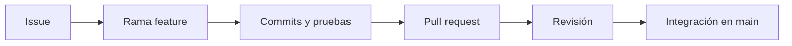

# 15. Flujos de trabajo profesionales

## 15.1. ¿Qué es un flujo de trabajo Git?

Git permite muchas formas de colaborar. Un **flujo de trabajo** es el conjunto de acuerdos sobre ramas, commits, revisiones y publicaciones que utiliza un equipo. No existe un único flujo obligatorio: se elige según tamaño, frecuencia de entregas y necesidades del proyecto.

## 15.2. GitHub Flow

Es un modelo sencillo basado en una rama principal y ramas de trabajo de corta duración:

1. `main` conserva una versión estable según los criterios del equipo.
2. Cada tarea se desarrolla en una rama con nombre descriptivo.
3. Se publican commits y se abre una PR.
4. Se revisan y prueban los cambios.
5. Se integran en `main` y se elimina la rama cuando deja de ser necesaria.



Es un punto de partida apropiado para proyectos intermodulares de equipos pequeños.

## 15.3. Git Flow

Git Flow propone un modelo más estructurado con ramas como `main`, `develop`, `feature/*`, `release/*` y `hotfix/*`. Puede ser útil en proyectos con ciclos de publicación planificados, pero añade complejidad. No es necesario aplicarlo a todos los proyectos ni confundirlo con el funcionamiento interno de Git.

| Aspecto | GitHub Flow | Git Flow |
|---|---|---|
| Ramas principales | Normalmente `main` | Habitualmente `main` y `develop` |
| Integración | PR frecuente | Integración según tipo de rama |
| Complejidad | Menor | Mayor |
| Uso típico | Entregas frecuentes | Ciclos de versión más estructurados |

## 15.4. Rebase frente a merge

`merge` integra historiales y puede crear un commit de fusión. `rebase` reproduce commits sobre otra base, cambiando sus identificadores. Ambos pueden ser útiles, pero **no conviene hacer rebase de commits compartidos** sin coordinación porque reescribe historia.

Ejemplo de actualización de una rama privada:

```bash
git fetch origin
git switch feature/menu
git rebase origin/main
```

Si aparecen conflictos, se resuelven y se continúa con `git rebase --continue`; para cancelar, `git rebase --abort`. Practica primero en un repositorio de prueba.

## 15.5. Integración continua: primera aproximación

Una comprobación automática puede ejecutar pruebas al abrir una PR. GitHub Actions permite definir flujos en `.github/workflows/`. Ejemplo básico de Java con Maven:

```yaml
name: Pruebas Java
on: [push, pull_request]
jobs:
  test:
    runs-on: ubuntu-latest
    steps:
      - uses: actions/checkout@v4
      - uses: actions/setup-java@v4
        with:
          distribution: temurin
          java-version: '21'
      - run: mvn -B test
```

El ejemplo presupone que el repositorio tiene un `pom.xml` válido y pruebas ejecutables. En proyectos reales revisa versiones y políticas de seguridad de las acciones antes de adoptarlas.

## 15.6. Acuerdos mínimos para un equipo de DAM

- Ramas con nombres descriptivos y vida limitada.
- Commits relacionados con una tarea concreta.
- PR con objetivo, cambios y comprobación realizada.
- Revisión por otro integrante antes de integrar.
- `main` siempre compilable según los requisitos del proyecto.
- Nunca publicar secretos ni datos personales reales.

## Actividad

Diseña un flujo para un equipo de tres estudiantes que desarrolla una aplicación de inventario. Define cómo asignar issues, nombrar ramas, revisar PR, resolver conflictos y preparar entregas. Justifica por qué eliges GitHub Flow o una alternativa.

**Siguiente:** [Problemas frecuentes](16-problemas.md).
